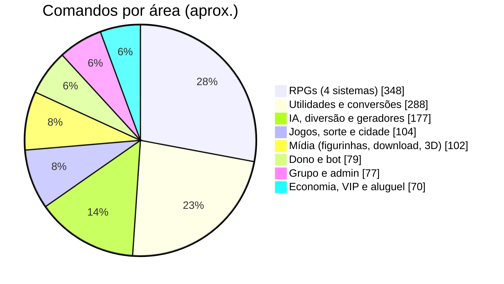
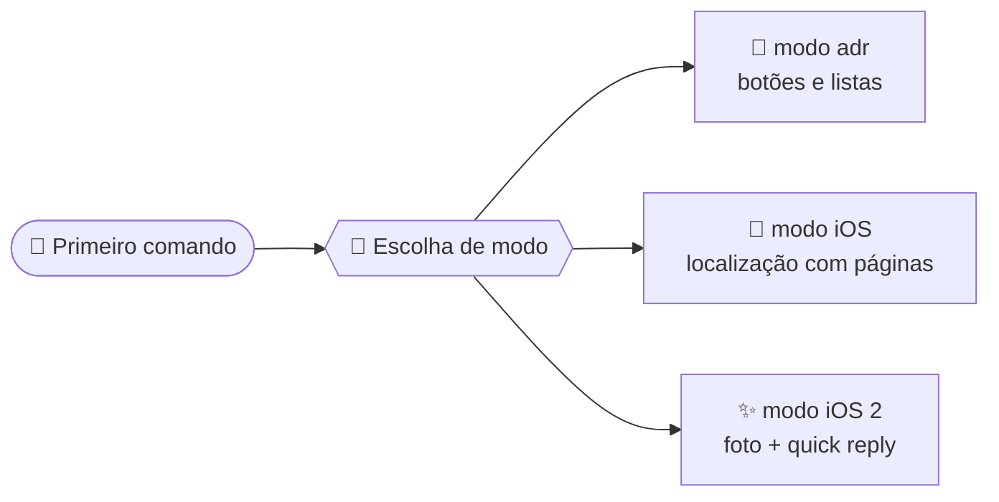
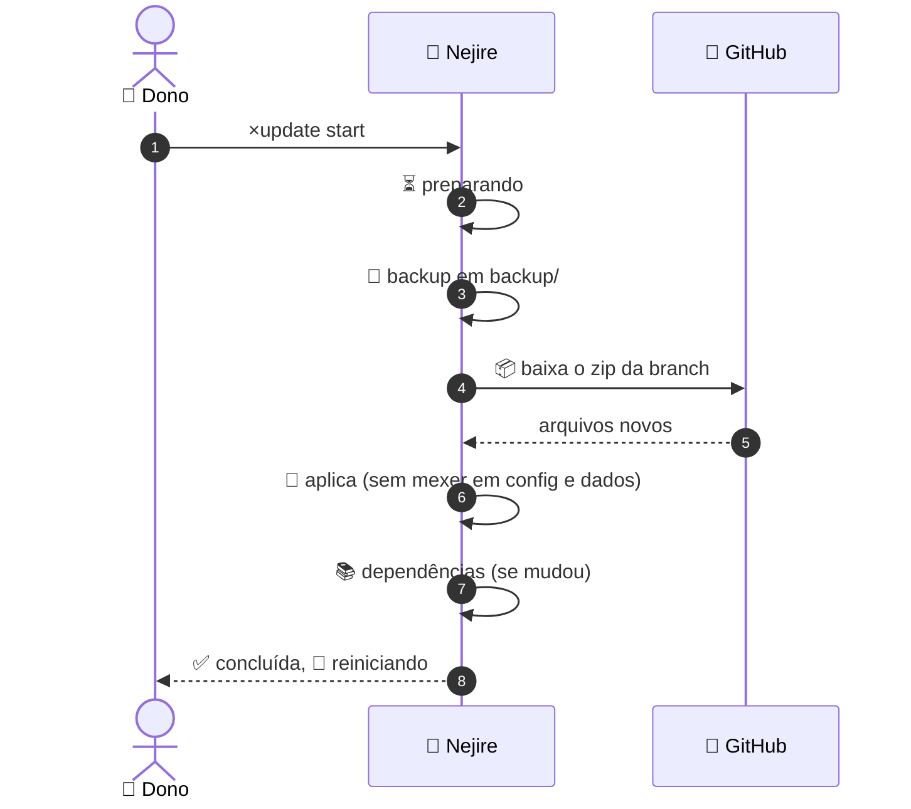

<div align="center">


<a href="https://git.io/typing-svg"></a>

<br/>


[](https://whatsapp.com/channel/0029Vb8rVXsDOQIWsbKuAd34)
[](https://wa.me/5567998229189)

</div>

> [!CAUTION]
> ### 🔒 Esta é a versão **OFUSCADA** (gratuita)
> O código está **ofuscado**: roda normalmente, mas **não dá para ler, editar ou aprender com ele** de forma direta.
> A **versão DESOFUSCADA** (código limpo, legível e editável) é **paga**, com o criador. Para comprar ou tirar dúvidas, chame o suporte: **[wa.me/5567998229189](https://wa.me/5567998229189)**.
>
> 🚫 **É proibido vender, revender ou cobrar** por esta versão. Se você pagou por ela, foi enganado(a).


## 📚 Índice

<table>
<tr>
<td>

1. [O que é](#-o-que-é)
2. [Novidades da 4.0](#-novidades-da-40)
3. [Recursos](#-recursos)
4. [Menus e modos](#-menus-e-modos)
5. [Play com card](#-play-com-card)
6. [Copiar mensagens](#-copiar-mensagens)
7. [Atualizar pelo GitHub](#️-atualizar-pelo-github)
8. [Requisitos](#-requisitos)

</td>
<td>

9. [Instalação](#️-instalação)
10. [Primeiro login](#-primeiro-login-pairing-code)
11. [Configuração](#️-configuração-configjson)
12. [Comandos principais](#-comandos-principais)
13. [Áudio do menu](#-áudio-do-menu)
14. [Menu auto](#-menu-auto)
15. [Estrutura](#️-estrutura-do-projeto)
16. [Segurança](#-segurança)
17. [Problemas comuns](#-problemas-comuns)
18. [Versão paga](#-versão-desofuscada-paga)
19. [Colaboradores e créditos](#-colaboradores-e-créditos)

</td>
</tr>
</table>

<div align="right"><a href="#">⬆️ voltar ao topo</a></div>

---

## 💙 O que é

O **System Nejire** é um bot de WhatsApp feito em **Node.js** com a biblioteca **Baileys** (`@systemzero/baileys`), inspirado na Nejire Hado. Todas as respostas seguem a decoração azul aesthetic: fontes miúdas, emojis azuis e molduras.

O login é por **código de pareamento** (sem QR code), então dá para rodar até no Termux.

<div align="center">

| 🩵 | 🎮 | 🎬 | 📱 | ♻️ |
|:-:|:-:|:-:|:-:|:-:|
| **1.200+**<br/>comandos | **4**<br/>RPGs completos | **Card**<br/>do play | **3**<br/>modos de menu | **Update**<br/>pelo GitHub |

</div>

---

## 🆕 Novidades da 4.0

> [!TIP]
> Principais mudanças desta versão. Os detalhes de cada uma estão nas seções abaixo.

| | Novidade | Como usar |
|:-:|---|---|
| 🔀 | **Escolha de modo** na primeira vez que a pessoa usa um comando | aparece sozinho, uma vez por pessoa |
| 📱 | **Modo iOS com paginação**: ◀ voltar, 📂 abrir e avançar ▶ | `×modo-ios` |
| ✨ | **Modo iOS 2**: foto no topo com botões de resposta rápida e lista "Selecionar" | `×modo-ios2` |
| 🤖 | **Modo adr** (Android): menus com botões e listas | `×modo-adr` |
| 🎬 | **Card do play** em estilo vinil e clássico, revezando a cada geração | `×play nome da música` |
| 🎧 | **Play no iOS** com dois botões: 🎵 áudio e 🎬 vídeo | `×play` no iPhone |
| 📋 | **Copiar no privado**: em grupo, a cópia vai para o seu PV, com prévia | responda uma mensagem com `×copiar` |
| 🎨 | **Moldura própria em cada categoria** (o menu principal continua igual) | `×menu` → abra uma categoria |
| ⏳ | **Botões expiram em 10 minutos** depois do menu ser enviado | automático |
| 🔗 | **Opções no menu de comandos**: canal, mini games, alugar, site, painel, copiar prefixo e avaliar | dentro de "Menus de Comandos" |
| 📡 | **Selo de canal encaminhado** nos menus | automático |
| 📇 | **vCard do bot** enviado junto do menu de play | automático |
| ♻️ | **`×update`**: atualiza o bot direto pelo GitHub, com backup antes | `×update` e `×update start` |

---

## ✨ Recursos

<details open>
<summary><b>🧩 Áreas do bot</b></summary>

<br/>

| | Área | O que tem |
|:-:|---|---|
| 👑 | **Dono** | broadcast, backup, ligar/desligar comandos, donos, trocar nome/foto/recado, `pcase`, `update` |
| 🫐 | **Admin** | antis (link, figurinha, imagem, vídeo, áudio, documento, trava, fake, canal, bot…), ban, promover, rebaixar, advertências, `postarstatus` |
| 🐚 | **Boas-vindas** | mensagem de entrada e saída, configurável |
| 🗣️ | **Figurinhas** | criar, converter, cortar, bordas, efeitos, trocar pack e autor |
| 🏊 | **Download** | play (áudio e vídeo), TikTok, Instagram, Spotify, Pinterest, letra, `gitclone` e `npm` em zip |
| 🧊 | **Cubo 3D** | renderizador 3D próprio: imagem, vídeo e figurinha |
| 🌊 | **IA e diversão** | IA de conversa, modo AI com memória, memes, frases, curiosidades |
| 🧩 | **Utilidades** | calculadoras, conversores, texto, data e hora, validadores |
| 🛠️ | **Ferramentas npm** | cards, QR e pix, OCR, PDF, agenda, xadrez |
| 🕵️ | **Detetive** | investigação com casos completos |
| 🎲 | **Jogos e sorte** | quiz, roleta, dados, loteria, cartas, sinuca, forca, jogo da velha |
| 💞 | **Sociais** | namoro e casamento, tinder, zoeira |
| 💎 | **VIP e aluguel** | planos VIP e aluguel do bot para grupos |
| 🐾 | **Sistemas** | economia, XP, ranking, perfil, daily, trabalho, guildas, lembretes, tarefas, diário |
| 🎣 | **Pesca** | jogo de pesca com **mini app web** |
| 🎮 | **RPGs** | Minecraft RPG, Simulador de Vida, Miraculous RPG e Fantasia RPG |

</details>

<details>
<summary><b>➕ Outros recursos</b></summary>

<br/>

- 🤖 **Sub-bots**: qualquer pessoa pode virar um sub-bot (`×subbot 5511999999999`).
- 🧠 **Modo AI**, **antipv**, **anticall**, **autoler**, **presença** e **autobackup**.
- 🚫 **`×bangp`**: neste grupo o bot só responde o dono.
- 🧪 **`×testarzone`**: testa todos os endpoints da API de uma vez.
- 📦 **Auto-instalação**: o `autoinstall.js` instala sozinho o que estiver faltando.

</details>

<details>
<summary><b>📊 Tamanho do projeto por área</b></summary>

<br/>



</details>

---

## 📱 Menus e modos

O bot tem **três modos de menu**. Na primeira vez que alguém usa um comando, o bot mostra os três com a explicação, e a pessoa escolhe com um botão ou digitando o comando.



| Modo | Comando | Como aparece |
|---|---|---|
| 🤖 **Adr** | `×modo-adr` | menus com botões e listas (Android) |
| 🍎 **iOS** | `×modo-ios` | localização com ◀ voltar, 📂 abrir e avançar ▶ |
| ✨ **iOS 2** | `×modo-ios2` | foto no topo, quick reply e lista "Selecionar" |

- O **menu principal** tem visual próprio e não muda entre categorias.
- Cada **categoria** (download, figurinhas, pesca, menuadmin…) tem uma **moldura diferente**.
- Os botões de menu **expiram em 10 minutos**. Depois disso, o bot avisa para pedir o menu de novo.

> [!TIP]
> Mande `×menu` para ver tudo. Mande `×info <comando>` para saber o que um comando faz.

---

## 🎬 Play com card

O `×play` mostra um **card** da música antes do menu de opções. O card é a **imagem do próprio menu**, sem mensagem separada.

| Estilo | Visual |
|---|---|
| 💿 **Vinil** | a capa vira um disco com sulcos, anel de progresso e rótulo "PLAY • tempo" |
| 🎞️ **Clássico** | capa de fundo, moldura de play e linha do tempo |
| 🔁 **Revezamento** | um play sai no vinil, o próximo no clássico, e assim por diante |

Também tem: nome limpo (sem "Official Video" ou "[HD]"), foto e nome de quem pediu, e a marca **by Lopes**.

- **Android**: menu com botões e lista (áudio, vídeo, letra e mais).
- **iPhone**: card com dois botões, 🎵 **áudio** e 🎬 **vídeo**.

> [!NOTE]
> O card não aparece em `×playvid`, na lista de resultados do `×play2` nem no `×playmenu`.

---

## 📋 Copiar mensagens

O `×copiar` copia a mensagem respondida.

- **Em grupo**: a cópia vai para o **seu PV**, primeiro com uma **prévia** (tipo da mensagem e de qual grupo), depois o arquivo. No grupo, o bot só reage com 📩.
- **No PV**: a cópia sai no próprio chat.
- **Para outro chat**: só o dono pode informar um destino.

---

## ♻️ Atualizar pelo GitHub

| Comando | O que faz |
|---|---|
| `×update` | compara a versão instalada com a do GitHub |
| `×update start` | atualiza em etapas e reinicia o bot |



> [!IMPORTANT]
> Preencha o repositório no `config.json`:
> ```json
> "atualizacao": { "repo": "kauanbreno179-stack/System-Nejire", "branch": "main" }
> ```
> O repositório precisa ser **público**, com o projeto na raiz. Rode o bot com um gerenciador de processos (PM2) para voltar sozinho depois do reinício.

---

## 🧾 Requisitos

-  e **npm** (recomendado Node 20+)
-  instalado (figurinhas animadas, áudio e vídeo)
- 📱 Um **número de WhatsApp só para o bot**
- 🌐 Internet estável

<div align="center">


</div>

---

## 🛠️ Instalação

<details open>
<summary><b>🐧 Linux / VPS (Ubuntu, Debian)</b></summary>

```bash
sudo apt update && sudo apt install -y git ffmpeg nodejs npm
git clone https://github.com/kauanbreno179-stack/System-Nejire.git
cd System-Nejire
npm install
```

</details>

<details>
<summary><b>📱 Termux (Android)</b></summary>

```bash
pkg update && pkg upgrade -y
pkg install -y git nodejs ffmpeg
git clone https://github.com/kauanbreno179-stack/System-Nejire.git
cd System-Nejire
npm install
```

</details>

<details>
<summary><b>🪟 Windows</b></summary>

1. Instale o [Node.js LTS](https://nodejs.org) e o [Git](https://git-scm.com).
2. Instale o [ffmpeg](https://ffmpeg.org/download.html) e coloque no `PATH`.
3. No terminal:

```bash
git clone https://github.com/kauanbreno179-stack/System-Nejire.git
cd System-Nejire
npm install
```

</details>

> [!NOTE]
> O `autoinstall.js` roda ao iniciar o bot e instala sozinho o que estiver faltando.

---

## 🔑 Primeiro login (pairing code)

1. Configure o `config.json`, principalmente o **`numeroDono`**.
2. Inicie o bot com `npm start`.
3. Digite o número do bot, com DDI e DDD, só números. Exemplo: `5511999999999`.
4. Aparece um **código de 8 caracteres**.
5. No WhatsApp do bot: **Aparelhos conectados → Conectar um aparelho → Conectar com número de telefone**. Digite o código **em até 60 segundos**.
6. Quando aparecer `✅ System Nejire conectada!`, está pronto.

A sessão fica em `sessions/main`. Nas próximas vezes, o bot conecta sozinho.

> [!WARNING]
> Se a sessão quebrar, apague `sessions/main` e faça o pareamento de novo. **Nunca suba `sessions/` para o GitHub**, é o login do bot.

---

## ⚙️ Configuração (`config.json`)

| Campo | Para que serve |
|---|---|
| `nome` | Nome do bot, usado nos menus e rodapés |
| `versao` | Versão exibida (`4.0`) |
| `prefixo` | Prefixo dos comandos (`×`) |
| `numeroDono` | **Seu número**, com DDI e DDD. Libera os comandos de dono |
| `nomeDono` | Seu nome |
| `canal` | `id`, `nome` e `url` do canal do WhatsApp |
| `siteOficial` | Link do site (aparece no menu de opções) |
| `plataforma.padrao` | `android`, `iphone` ou `auto` |
| `webapp` | `habilitado`, `porta` e `urlPublica` do mini app de pesca |
| `zoneApi` | URL, **sua apikey** e endpoints de IA, TTS e buscas |
| `lopesApi` | URL e **seu token** da API dos downloaders |
| `atualizacao` | `repo` e `branch` usados pelo `×update` |
| `boasVindas` | Textos de entrada e saída (`@user`, `@group` e `@membros` são trocados) |
| `vip` e `aluguel` | Planos, dias e preços |

> [!IMPORTANT]
> Coloque **a sua apikey** em `zoneApi.apikey` e **o seu token** em `lopesApi.token`. Sem eles, IA, TTS, buscas e downloads não funcionam. Depois teste com `×testarzone`.

---

## 🚀 Comandos principais

| Comando | O que faz |
|---|---|
| `×menu` | Menu principal (e a escolha de modo, na primeira vez) |
| `×modo-adr` · `×modo-ios` · `×modo-ios2` | Escolhe o modo de menu |
| `×info <comando>` | Descrição de um comando |
| `×ping` | Testa se o bot está vivo |
| `×figurinha` | Figurinha de uma imagem ou vídeo (envie ou responda) |
| `×play <música>` | Card do play e menu de opções |
| `×copiar` | Copia a mensagem respondida (no seu PV, em grupo) |
| `×pesca` | Painel de pesca |
| `×rpgs` | Lista os 4 RPGs |
| `×alugar` | Planos de aluguel |
| `×subbot <número>` | Cria um sub-bot |
| `×update` | Verifica atualização no GitHub (dono) |
| `×addcase <pedido>` | A IA cria um comando novo (dono) |
| `×pcase <comando>` | Manda a case de um comando em zip (dono) |

---

## 🎧 Áudio do menu

O dono marca um áudio e o bot passa a mandá-lo **logo depois do menu**, toda vez que alguém pedir.

1. Envie o áudio no chat com o bot.
2. **Responda esse áudio** com `×definiraudiomenu`.
3. Teste com `×testaraudiomenu`.

| Comando (dono) | O que faz |
|---|---|
| `×definiraudiomenu` | Salva o áudio marcado |
| `×audiomenu` | Mostra o status |
| `×audiomenu on` / `off` | Liga ou desliga sem apagar |
| `×testaraudiomenu` | Manda o áudio só para você |
| `×removeraudiomenu` | Apaga o áudio salvo |

> [!NOTE]
> Limite de **16 MB**. Se o áudio falhar, o menu continua saindo normalmente.

---

## 🤖 Menu auto

Comandos que ficam **ligados** e agem sozinhos. Exemplo: com `×autofigu` ligado, toda imagem, vídeo ou GIF vira figurinha na hora.

| Comando | O que faz |
|---|---|
| `×autofigu` | imagem, vídeo e GIF viram figurinha |
| `×autoemoji` | mensagem só com um emoji vira figurinha do emoji |
| `×autotoimg` | figurinha vira imagem |
| `×autodl` | link de TikTok, Instagram e YouTube Shorts baixa o vídeo |
| `×autoreact` | o bot reage nas mensagens com um emoji |
| `×menuauto` | abre o menu dos automáticos |

Cada pessoa tem o **próprio pack e autor** das figurinhas automáticas (`×autopack` e `×autoautor`).

---

## 🗂️ Estrutura do projeto

<details>
<summary><b>📁 Ver a árvore de pastas</b></summary>

```
System-Nejire/
├── connect.js          # ponto de entrada (npm start)
├── index.js            # handler central dos comandos
├── config.json         # configuração do bot
├── SISTEMAS/           # a lógica dos comandos, um arquivo por sistema
│   ├── play2/          # play, card e menu de opções
│   ├── infocmd/        # descrições dos comandos (×info)
│   ├── auto/           # menu auto
│   ├── lote3/          # os 4 RPGs
│   └── ...
├── menu/               # menus, botões, fotos e áudio do menu
├── utils/              # card do play, menus de localização, device, atualizador
├── webapp/             # mini app web da pesca
├── assets/             # fontes e arquivos de apoio
├── data/               # dados fixos do jogo
├── database/           # dados dos usuários (criados automaticamente)
└── sessions/           # sessão do WhatsApp (não sobe para o GitHub)
```

</details>

---

## 🔐 Segurança

> [!CAUTION]
> - 🚫 **Nunca suba** `sessions/`, `database/` nem o `config.json` com chaves reais.
> - 🔑 Guarde sua apikey e seu token só no seu servidor.
> - 👑 Só coloque como dono quem você confia.
> - 🧠 Leia com `×vercase` o código criado pela IA antes de liberar.
> - 📵 Use um número só para o bot.

---

## 🩹 Problemas comuns

<details>
<summary><b>Ver a tabela de problemas e soluções</b></summary>

<br/>

| Problema | Solução |
|---|---|
| O código de pareamento não conecta | Digite em até 60 s, com DDI e DDD. Se falhar, apague `sessions/main` |
| `Sessão deslogada` / `403` | Apague `sessions/main` e faça o pareamento de novo |
| `Conflito: outra sessão ativa` | Feche a outra instância conectada com o mesmo número |
| Figurinha, áudio ou vídeo não funciona | Instale o **ffmpeg** |
| O menu não tem botões | Escolha o modo com `×modo-adr` |
| O card do play não aparece | Confira se `utils/` está completa e reinicie o bot |
| `×update` diz que não tem repositório | Preencha `atualizacao.repo` no `config.json` |
| IA, TTS ou busca não respondem | Confira a apikey em `zoneApi` e rode `×testarzone` |
| Download não funciona | Confira o token em `lopesApi` |
| Erro de módulo não encontrado | Rode `npm install` |

</details>

---

## 🔓 Versão desofuscada (paga)

Esta versão é **gratuita e ofuscada**. A versão **desofuscada** tem o código limpo, legível e editável, com:

- 📖 código aberto para estudo e personalização
- 🛠️ suporte direto com o criador
- 🔄 acesso às atualizações

<div align="center">

[](https://wa.me/5567998229189)

</div>

---

## 👥 Colaboradores e créditos

<div align="center">

<table>
<tr>
<td align="center" width="260">
<a href="https://github.com/GabsBillie">
<br/>
<b>GabsBillie</b>
</a><br/>
<sub>colaboradora</sub>
</td>
<td align="center" width="260">
<br/>
<b>Lopes</b><br/>
<sub>criador</sub>
</td>
</tr>
</table>

**👥 Todos os colaboradores**

<a href="https://github.com/kauanbreno179-stack/System-Nejire/graphs/contributors">
  
</a>

</div>

| | |
|---|---|
| 👤 **Criador** | **Lopes** (by Lopes) |
| 👩‍💻 **Colaborador** | [GabsBillie](https://github.com/GabsBillie) |
| 🎨 **Design das artes** | **Mikkira** |
| 📚 **Base** | [Baileys](https://www.npmjs.com/package/@systemzero/baileys) (`@systemzero/baileys`) |
| 💬 **Suporte** | [5567998229189](https://wa.me/5567998229189) |
| 📢 **Canal** | [Seguir o canal](https://whatsapp.com/channel/0029Vb8rVXsDOQIWsbKuAd34) |
| 📄 **Licença** | MIT |

> [!CAUTION]
> ✖ **Proibido vender, revender ou cobrar** por esta versão, total ou parcialmente.
> ✖ **Proibido remover os créditos** do criador e dos colaboradores.
> ✔ Pode usar para uso próprio, mantendo os créditos.

---

## 📈 Estatísticas

<div align="center">

<a href="https://github.com/kauanbreno179-stack/System-Nejire">
  
</a>

<br/><br/>


<br/><br/>

<a href="https://star-history.com/#kauanbreno179-stack/System-Nejire&Date">
  
</a>

<br/><br/>


</div>

<br/>

<div align="center">

**⋆｡° 𓆩🩵𓆪 System Nejire 4.0 𓆩🩵𓆪 °｡⋆**

🩵 Feito com muito carinho, by **Lopes** 🩵


</div>
